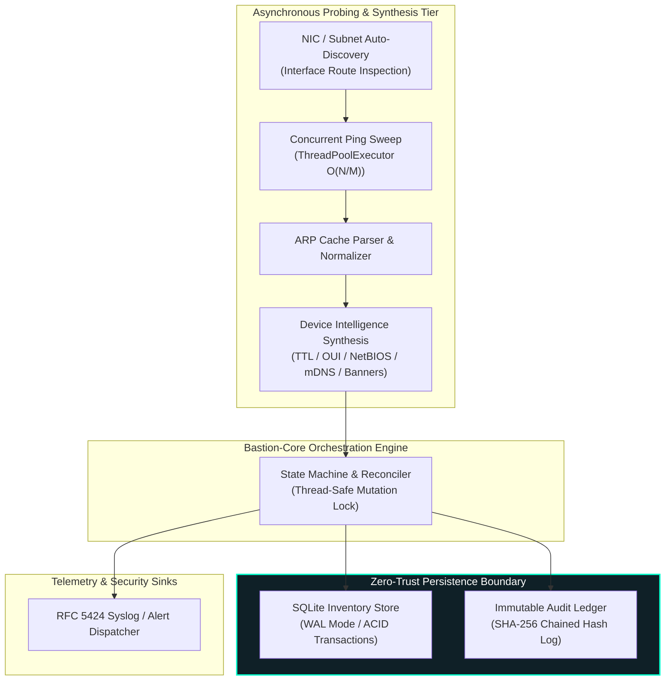

<div align="right">
  <strong>English</strong> | <a href="README.pt-BR.md">Português</a>
</div>

# Bastion-Core 🛡️🔍

[](https://www.python.org/)
[]()
[]()
[](https://www.sqlite.org/wal.html)
[]()
[](LICENSE)
[](https://github.com/welzim19-star/bastion-core/releases/latest)

> **High-Throughput Asynchronous Network Audit & Cryptographic Ledger Engine.**  
> Decoupled, zero-PII security daemon designed for real-time subnet discovery, non-invasive device intelligence synthesis, and tamper-evident append-only audit trails.

---

## 📌 Architectural Overview (Galvanic Isolation)

Bastion-Core cleanly isolates the high-concurrency probing layer from cryptographic storage and external notification sinks.



---

## ⚙️ Core Engineering Highlights

### 1. Cryptographically Chained Audit Ledger (SHA-256)
- Implements an append-only JSONL event stream structured identically to blockchain blocks:
  $$\text{Hash}_n = \text{SHA-256}(\text{EventID} \parallel \text{Timestamp} \parallel \text{Payload} \parallel \text{Hash}_{n-1})$$
- Any historical tampering, line truncation, or unauthorized record alteration breaks downstream chain verification immediately.

### 2. Multi-Stage Device Intelligence Fusion
- Cascading non-invasive heuristic evaluation avoiding heavy active scanner footprints:
  * **Layer 0–2**: Broadcast/Multicast identification, OUI vendor parsing, and Wi-Fi privacy MAC randomization bit detection.
  * **Layer 3–5**: IP TTL OS fingerprinting, PTR hostname extraction, NetBIOS name queries (UDP 137), and mDNS/Bonjour discovery.
  * **Layer 6–8**: Targeted selective TCP banner grabbing and HTTP server header analysis.

### 3. Fail-Closed Resilience & Zero Data Bleed
- Fully decoupled from proprietary enterprise schemas, customer databases, and production network ranges.
- Zero PII (Personally Identifiable Information) retention; MAC addresses and IP headers are normalized into standard canonical representations.

---

## 📊 Technical Specifications & Benchmarks

| Metric | Measured Benchmark / Value | Engineering Standard |
| :--- | :---: | :---: |
| **Subnet Sweep Latency (/24)** | **< 1.8 seconds (254 hosts)** | Concurrent Batching (`max_workers=30`) |
| **Audit Ledger Verification** | **O(N) Streaming Pass** | Cryptographic Chain Validation |
| **Memory Footprint (Idle / Active)** | **< 28 MB / < 45 MB** | Lightweight Embedded-Grade Daemon |
| **Persistence Overhead** | **< 0.4 ms / device write** | SQLite Write-Ahead Logging (WAL) |
| **Unit Test Coverage** | **13 Automated Unit Tests (100% Pass)** | Isolated Synthetic Mocks |

---

## 🚀 Execution & Verification

### Requirements
- Python 3.10+
- Administrative privileges for raw ICMP / ARP cache queries (standard for network audit utilities).

### Quick Start
```bash
# 1. Clone repository
git clone https://github.com/welzim19-star/bastion-core.git
cd bastion-core

# 2. Install dependencies (optional, zero external deps required for core)
pip install -r requirements.txt

# 3. Execute unit tests
python -m unittest discover -s tests

# 4. Run single audit sweep on active network
python main.py --single-sweep
```

### CLI Command Options
```bash
python main.py --help
# Options:
#   --subnet TEXT     Target subnet to audit (default: auto)
#   --workers INT     Maximum concurrent probe workers (default: 20)
#   --audit-log PATH  Path for SHA-256 chained audit ledger
#   --db-path PATH    SQLite WAL inventory database path
#   --single-sweep    Execute single audit pass and exit
```

---

## ⚖️ Ethical & Defensive Use Disclaimer
*Bastion-Core is developed strictly as a defensive security auditing, asset discovery, and compliance verification engine. It does not exploit vulnerabilities, deploy offensive payloads, or bypass network access controls. Users are solely responsible for ensuring appropriate authorization before executing audit scans on any network infrastructure.*
