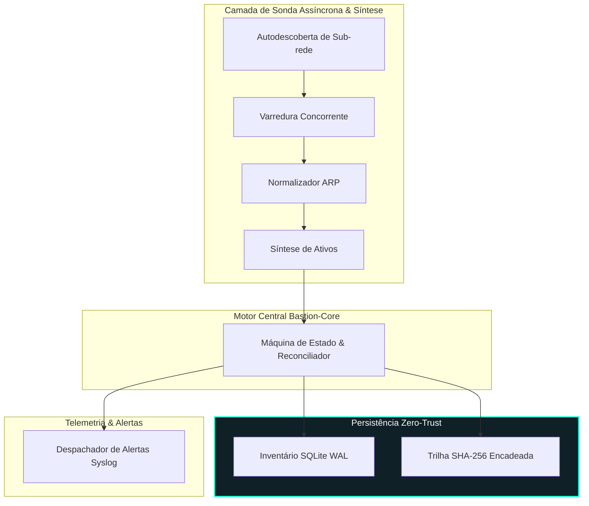

<div align="right">
  <a href="README.md">English</a> | <strong>Português</strong>
</div>

# Bastion-Core 🛡️🔍

[](https://www.python.org/)
[]()
[]()
[](https://www.sqlite.org/wal.html)
[]()
[](LICENSE)
[](https://github.com/welzim19-star/bastion-core/releases/latest)
[](https://github.com/welzim19-star/bastion-core/actions/workflows/ci.yml)
[](https://render.com/deploy?repo=https://github.com/welzim19-star/bastion-core)

> **Motor Assíncrono de Auditoria de Rede e Registro Criptográfico Imutável.**  
> Daemon defensivo desacoplado com sanitização estrita (Zero-PII), projetado para descoberta de ativos em tempo real, inteligência de dispositivos não invasiva e trilha de auditoria inviolável encadeada por SHA-256.

> [!NOTE]
> **Arquitetura: Sensor de Borda (Edge) vs. Vitrine em Nuvem (Render):**  
> Em ambientes corporativos reais, o Bastion-Core opera localmente como um **Sensor de Borda (Edge Daemon)** com acesso direto à placa de rede física (tabelas ARP, escuta multicast mDNS e pacotes de broadcast da camada 2). Quando publicado na nuvem (como no Render), ele atua em **Modo Console de Auditoria**: servindo o dashboard interativo em tempo real, validando a integridade da trilha criptográfica (hashes SHA-256 encadeados e SQLite WAL) e expondo a API REST de auditoria sem a necessidade de acessar redes privadas.

---

## 📌 Visão Arquitetural (Isolamento Galvânico)

O Bastion-Core isola completamente a camada de varredura concorrente de rede da persistência criptográfica e dos pontos de integração externa.



---

## ⚙️ Conquistas Centrais de Engenharia

### 1. Trilha de Auditoria com Encadeamento Criptográfico (SHA-256)
- Implementação de um fluxo de eventos imutável (*append-only*) em formato JSONL modelado sob princípios de encadeamento criptográfico:
  $$\text{Hash}_n = \text{SHA-256}(\text{EventID} \parallel \text{Timestamp} \parallel \text{Payload} \parallel \text{Hash}_{n-1})$$
- Qualquer tentativa de adulteração de registros passados, truncamento de linhas ou modificação de dados quebra imediatamente a verificação de integridade da cadeia.

### 2. Fusão Multi-Camadas de Inteligência de Dispositivos
- Avaliação heurística não invasiva que evita footprints agressivos de scanners ativos:
  * **Camadas 0–2**: Identificação de tráfego Broadcast/Multicast, resolução de fabricante OUI e detecção de bits de randomização de MAC (privacidade Wi-Fi).
  * **Camadas 3–5**: Fingerprinting de sistema operacional via TTL de pacote IP, resolução reversa de hostname PTR, requisições NetBIOS (UDP 137) e descoberta mDNS/Bonjour.
  * **Camadas 6–8**: Coleta seletiva de banners TCP e análise de cabeçalhos de servidores HTTP.

### 3. Resiliência com Falha Fechada (*Fail-Closed*) & Zero Vazamento de Dados
- Totalmente desacoplado de esquemas proprietários corporativos, credenciais reais ou faixas de IP confidenciais.
- Zero retenção de PII (*Personally Identifiable Information*); endereços MAC e IPs são rigorosamente normalizados e auditados.

---

## 📊 Especificações Técnicas & Benchmarks

| Métrica | Benchmark Mensurado / Valor | Padrão de Engenharia |
| :--- | :---: | :---: |
| **Latência de Varredura de Sub-rede (/24)** | **< 1,8 segundos (254 hosts)** | Lotes Concorrentes (`max_workers=30`) |
| **Verificação de Trilha de Auditoria** | **Varredura Contínua O(N)** | Validação Criptográfica em Cadeia |
| **Consumo de Memória (Ocioso / Carga)** | **< 28 MB / < 45 MB** | Daemon Leve para Sistemas Embarcados |
| **Sobrecarga de Persistência** | **< 0,4 ms / registro** | SQLite Write-Ahead Logging (WAL) |
| **Cobertura de Testes Unitários** | **13 Testes Unitários (100% de Aprovação)** | Mocks Sintéticos Isolados |

---

## 🚀 Execução & Verificação

### Requisitos
- Python 3.10 ou superior
- Privilégios administrativos/root para emissão de pacotes ICMP brutos e leitura de ARP (comum em ferramentas de infraestrutura).

### Início Rápido
```bash
# 1. Clonar o repositório
git clone https://github.com/welzim19-star/bastion-core.git
cd bastion-core

# 2. Instalar dependências (opcional; o núcleo opera sem dependências externas obrigatórias)
pip install -r requirements.txt

# 3. Executar os testes unitários automatizados
python -m unittest discover -s tests

# 4. Executar uma varredura única de auditoria na rede local
python main.py --single-sweep
```

### Opções de Linha de Comando (CLI)
```bash
python main.py --help
# Opções:
#   --subnet TEXT     Sub-rede alvo da auditoria (padrão: auto)
#   --workers INT     Máximo de workers concorrentes (padrão: 20)
#   --audit-log PATH  Caminho do ledger de auditoria SHA-256
#   --db-path PATH    Caminho do banco SQLite WAL de inventário
#   --single-sweep    Executa varredura única e encerra
```

---

## ⚖️ Aviso Legal & Uso Ético Defensivo
*O Bastion-Core foi desenvolvido estritamente para finalidades de auditoria de segurança defensiva, descoberta de ativos e validação de conformidade técnica. O software não explora vulnerabilidades, não propaga payloads ofensivos nem contorna controles de acesso de rede. A autorização formal prévia é de exclusiva responsabilidade do operador ao executar auditorias em qualquer infraestrutura.*
